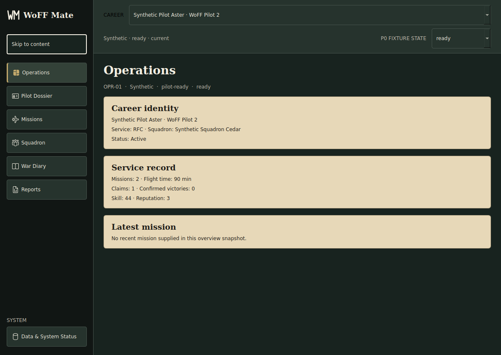
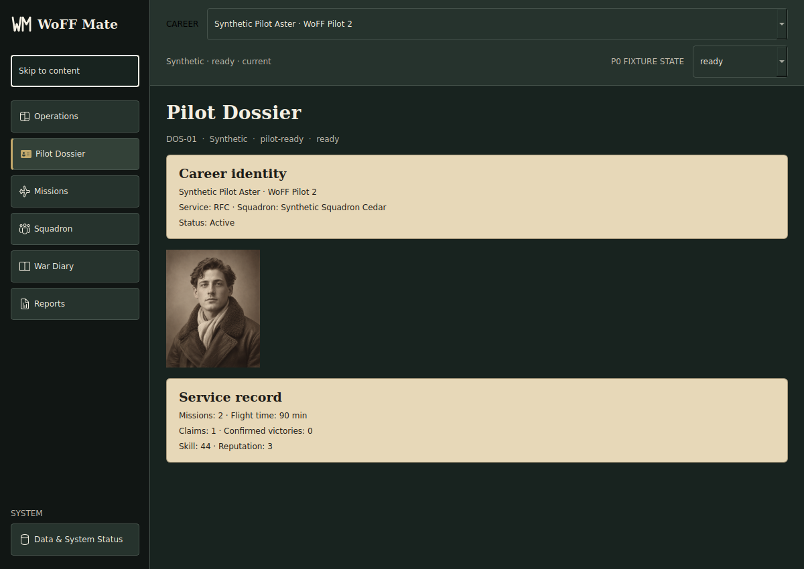

<p align="center">
  <picture>
    <source media="(prefers-color-scheme: dark)" srcset="woff/assets/ui/branding/woff_mate_wordmark_light.svg">
    
  </picture>
</p>

<h1 align="center">WoFF Mate</h1>

<p align="center"><strong>Your campaign's story, beyond the cockpit.</strong></p>

<p align="center">
  An independent, open-source and local-first companion for
  <em>Wings Over Flanders Fields: Between Heaven &amp; Hell II</em>.
  Follow pilot careers, missions, squadrons and the records that give a campaign its history.
</p>

<p align="center">
  <a href="https://woff-mate-ui-v2.pilotohans.chatgpt.site/">Explore the UI V2 design</a> ·
  <a href="#quick-start">Get started</a> ·
  <a href="#development-roadmap">Development roadmap</a> ·
  <a href="https://github.com/Malboro66/woff-mate/issues">Issues</a>
</p>

[](https://github.com/Malboro66/woff-mate/actions/workflows/ci.yml)
[](https://www.python.org/)
[](docs/compatibility.md)
[](LICENSE)


> **Development software, not a public release.** The existing ingestion, local SQLite storage, CLI and campaign-domain code are evolving under explicit data-safety requirements. **Product Gates A–D are not approved**, and production P1 desktop/live-data integration, a public installer, launcher and social RPG are **not** authorized or complete. The published UI V2 is a **design reference**, not the live product.

## What WoFF Mate is building

The goal is a companion that makes a WOFF career easier to explore without taking control of the simulator's campaign files. It observes game-generated sources, extracts supported records, maintains a local database and lays the groundwork for deeper squadron life.

| Area | Current evidence | Boundary |
|---|---|---|
| **Campaign core and CLI** | File monitoring, stable-source ingestion, pilot/career records, missions, victories, awards, squadron context, local SQLite, queries/reports and diary/RPG foundations are implemented code paths. | Real-data reliability, recovery and full-app review remain subject to **Product Gate A**. |
| **Desktop P0** | Navigable PySide6/Qt Widgets prototype with synthetic careers and fixture-backed screens. | **Fixture-only**; no production live WOFF/SQLite binding. |
| **UI V2** | [Published visual design reference](https://woff-mate-ui-v2.pilotohans.chatgpt.site/) with Operations, Pilot Dossier, Missions, Squadron, War Diary and Reports. | A design site, **not** a production application or a game-connected demo. |
| **Experimental source preview** | [R0.3 immutable-copy diagnostic desktop preview](docs/ui/real-source-preview.md). | Explicitly selected **local copies** only; not a live database, sync or public product. |
| **Future product** | Retained desktop toolkit, planned read-only P1, installable companion, launcher and persistent social/RPG systems. | Separate scope, evidence and maintainer approvals required. |

The retained desktop UI toolkit is **PySide6 + Qt Widgets 6.11.2**, accepted as an architectural choice on 2026-10-05. This does **not** approve any product gate. See the [UI toolkit ADR](docs/architecture/adr-ui-toolkit.md) and [integrated governance checkpoint](docs/engineering/governance-checkpoint-2026-10-18.md).

## A look at the desktop direction

<p align="center">
  
  
</p>

*Screenshots from the historical **P0 fixture-backed desktop prototype** (Issue #140). These use synthetic data, are not production screens and do not show live WOFF integration. The separate [UI V2 site](https://woff-mate-ui-v2.pilotohans.chatgpt.site/) is the current visual design reference.*

## Current capabilities

- **Local-first, read-only WOFF sources:** monitor supported campaign files without intentionally writing back to game campaign data.
- **Career-aware pilot records:** maintain identities beyond display names and preserve historical career records.
- **Mission and combat records:** parse supported mission, victory, claim and decoration information without treating missing fields as known values.
- **Squadron context:** model known AI aircrew/wingman records and identity evidence.
- **Campaign RPG foundations:** maintain baseline fatigue, morale, stress and narrative/diary data; this is **not** the future interactive social RPG.
- **SQLite and recovery-focused engineering:** local persistence with tests, guarded migrations and explicit source/provenance boundaries.
- **Developer/diagnostic tools:** command-line ingest, queries and reports; read-only prototype and source-copy preview tracks remain separate.

## Development roadmap

1. **Reliable companion / Gate A:** finish outstanding ingestion, provenance and derived-state evidence; validate a bounded real-WOFF replay and recovery; obtain a new revision-bound Full Application Review and explicit maintainer decision.
2. **Desktop read-only vertical slice / applicable Gates A–B:** connect approved application query services to the retained Qt Widgets UI while preserving career identity and honest unknown/partial states.
3. **Installable alpha and companion beta:** deliver user-facing installation, diagnostics and ordinary flows only after their own packaging, recovery and distribution evidence.
4. **Headquarters and social RPG / applicable Gate C:** progressively add squadron relationships, persistent memory, morale, promotions, recovery, transfers and encounters, never inferring events without evidence.
5. **Public release / Gate D:** distribution and installer only after explicit final product, privacy, compatibility and release reviews.

This is a **direction of work, not a delivery schedule or permission to implement gated features**. Follow [GitHub Issues](https://github.com/Malboro66/woff-mate/issues), the [development board](https://github.com/users/Malboro66/projects/1) and the [product checkpoints](docs/engineering/product-milestones.md) for authoritative progress.

## Quick Start

### Requirements

- Windows 10 64-bit or Windows 11 64-bit
- Python 3.10 through 3.14
- *Wings Over Flanders Fields: Between Heaven & Hell II* (WOFF BH&H II)

### Install

```powershell
git clone https://github.com/Malboro66/woff-mate.git
cd woff-mate
python -m venv .venv
.\.venv\Scripts\Activate.ps1
python -m pip install --upgrade pip
pip install -e .
```

For development dependencies:

```powershell
pip install -e ".[dev]"
```

### Configure

Create a local configuration from the tracked example:

```powershell
Copy-Item config.example.json config.json
```

Then update `watch_paths` and `export_path` for your WOFF installation. Local `config.json` files, databases, logs, virtual environments, caches, and build outputs are intentionally not versioned.

### Run

```powershell
woff-watchdog
```

Useful commands:

```powershell
woff-watchdog --help
woff-watchdog --version
woff-watchdog --discover
woff-watchdog --parse-file "C:\path\to\Pilot1Dossier.txt"
woff-query --format json
woff-report --config config.json
```

All three installed commands use the same process contract: `0` means success,
`1` means a runtime failure, and `2` means invalid input, configuration, or a
missing required resource. JSON, CSV, and Markdown query output is written only
to stdout; diagnostics are written to stderr. See the
[command-line contracts](docs/command-line-contracts.md) for selectors, empty
results, report generation, and export-backup behavior.

## How It Works

```text
WOFF
  │
  ▼
Campaign files
  │
  ▼
Watchdog / stable snapshot ingestion
  │
  ▼
Parsers and normalization
  │
  ▼
Campaign engine
  │
  ├── Pilots
  ├── Missions
  ├── Victories
  ├── Wingmen
  ├── RPG state
  └── Diary entries
  │
  ▼
SQLite
  │
  ▼
WoFF Mate presentation layer / future UI
```

WoFF Mate is structured as a modular monolith: one Windows application and one local SQLite database, split into foundation, domain, persistence, platform, ingestion, application, presentation, and governance responsibilities.

### Career identity boundary

Stable `Pilot{N}Dossier.txt` snapshots establish the current career for a pilot
slot. `Log`, `Claims`, and `Squads` files may update that career only when the
simultaneously observed Dossier digest matches the stored binding. Confirmed
Dossier deletion or move-away releases only that campaign-root/slot binding;
historical careers remain queryable, and surviving slots are never renumbered.
Reuse after confirmed vacancy creates a separate career ID even for the same
display name. A different name also starts a new career in an occupied slot.
Temporary replacement and unavailable or incompletely scanned roots do not
prove vacancy. Same-name replacement without an observed vacancy remains the
separate evidence gap tracked by #87. See
[vacancy reconciliation](docs/troubleshooting.md#pilot-slot-vacancy) for recovery
and source-presence semantics.

Parsed campaign XML and `Mission.log` remain available to parser/reporting
workflows, but the live persistence path rejects them when they cannot supply
a supported career identity.

## Compatibility

The project targets Windows 10/11 and Python `>=3.10,<3.15`. CI currently exercises Python 3.10 and 3.14 on Linux, performs type checking with Pyright, and runs a Windows smoke/build path with Python 3.10.

WOFF BH&H II format support is limited to behavior confirmed by sanitized samples and regression tests. The exact WOFF build represented by the current sanitized samples has not yet been confirmed. See [compatibility and safe reporting](docs/compatibility.md) for the current support boundaries.

<!--
Compatibility-contract anchors retained for the existing documentation consistency test.
These phrases are intentionally non-rendered; the user-facing README is English.
Python da versão 3.10 até a 3.14
Windows 10 de 64 bits
Windows 11 de 64 bits
amostras sanitizadas
versão exata do WoFF ainda não foi confirmada
-->

## Project Status

**Active development — no public release or approved Product Gate A–D.** The application version is sourced from `woff/version.py`; schema and configuration versions evolve independently. The technical, architectural and issue-specific progress of the project must not be confused with product-release readiness.

The dated [2026-10-18 governance checkpoint](docs/engineering/governance-checkpoint-2026-10-18.md) documents the retained toolkit, completed reliability work and outstanding evidence. The current code, GitHub issues/PRs and independent revision-bound reviews take precedence over older descriptions. A green CI run or a successful fixture-backed UI preview is not a live-data, launcher or release approval.

## Documentation

The 2026-08-13 approved Master Plan remains the historical product direction.
For **current decisions and next steps**, use the
[2026-10-18 integrated governance checkpoint](docs/engineering/governance-checkpoint-2026-10-18.md)
alongside the executable project graph, eval catalog, quality gates, and
[product/review policy](docs/engineering/product-milestones.md). The checkpoint
does not itself approve Product Gates A-D; dated R1/R2 reviews remain
revision-bound historical evidence.

- [Architecture](docs/architecture/modular-monolith.md)
- [Executable project graph](docs/architecture/project-graph.yaml)
- [Integrated governance checkpoint — 2026-10-18](docs/engineering/governance-checkpoint-2026-10-18.md)
- [R1 integrity review (historical FAIL)](docs/engineering/r1-integrity-baseline.md)
- [First R2 review (historical HOLD)](docs/engineering/r2-ui-architecture-review.md)
- [Repeated R2 review (technical GO)](docs/engineering/r2-ui-architecture-review-repeat.md)
- [UI toolkit ADR](docs/architecture/adr-ui-toolkit.md)
- [Read-only UI foundation](docs/ui/read-only-foundation.md)
- [Shared screen-state matrix](docs/ui/screen-state-matrix.md)
- [Immutable UI application contracts](docs/ui/application-contracts.md)
- [UI/UX development standard](docs/ui/ui-development-standard.md)
- [Synthetic UI fixture inventory](woff/tests/fixtures/ui_states/README.md)
- [Published UI V2 prototype](https://woff-mate-ui-v2.pilotohans.chatgpt.site/)
- [UI V2 reference](docs/ui/ui-v2-reference.md)
- [UI V2 visual system](docs/ui/ui-v2-visual-system.md)
- [UI V2 design walkthrough](docs/ui/ui-v2-walkthrough.md)
- [UI V2 published-site audit](docs/ui/ui-v2-rendered-audit.md)
- [UI V2 executable conformance evidence](docs/ui/evidence/ui-v2-site-2026-09-01-audit-4/README.md)
- [Compatibility and safe reporting](docs/compatibility.md)
- [Database migrations and recovery](docs/database-migrations.md)
- [Command-line contracts](docs/command-line-contracts.md)
- [Troubleshooting](docs/troubleshooting.md)
- [Engineering evals](docs/engineering/evals.md)
- [Quality gates](docs/engineering/quality-gates.md)
- [Product demonstrability and full-application reviews](docs/engineering/product-milestones.md)
- [Progressive autonomy](docs/engineering/autonomy.md)

## Development

Install the development dependencies and run the same core checks used by CI:

```powershell
pip install -e ".[dev]"
python scripts/validate_project_graph.py
python -m pytest -q
pyright
```

The GitHub Actions workflow also builds and inspects the Python wheel, imports installed modules, exercises installed entry points, and performs a Windows PyInstaller smoke build.

See [CONTRIBUTING.md](CONTRIBUTING.md) before opening a pull request.

## Contributing

Contributions, bug reports, sanitized compatibility samples, documentation improvements, and focused pull requests are welcome. Please read [CONTRIBUTING.md](CONTRIBUTING.md) and use the existing issue tracker to coordinate non-trivial changes.

For security-sensitive reports, follow [SECURITY.md](SECURITY.md) rather than opening a public issue.

## License

WoFF Mate is released under the [MIT License](LICENSE).

## Disclaimer

WoFF Mate is an independent, community-developed companion application and is not affiliated with or endorsed by OBD Software.

*Wings Over Flanders Fields*, related names, trademarks, and game assets belong to their respective owners.
